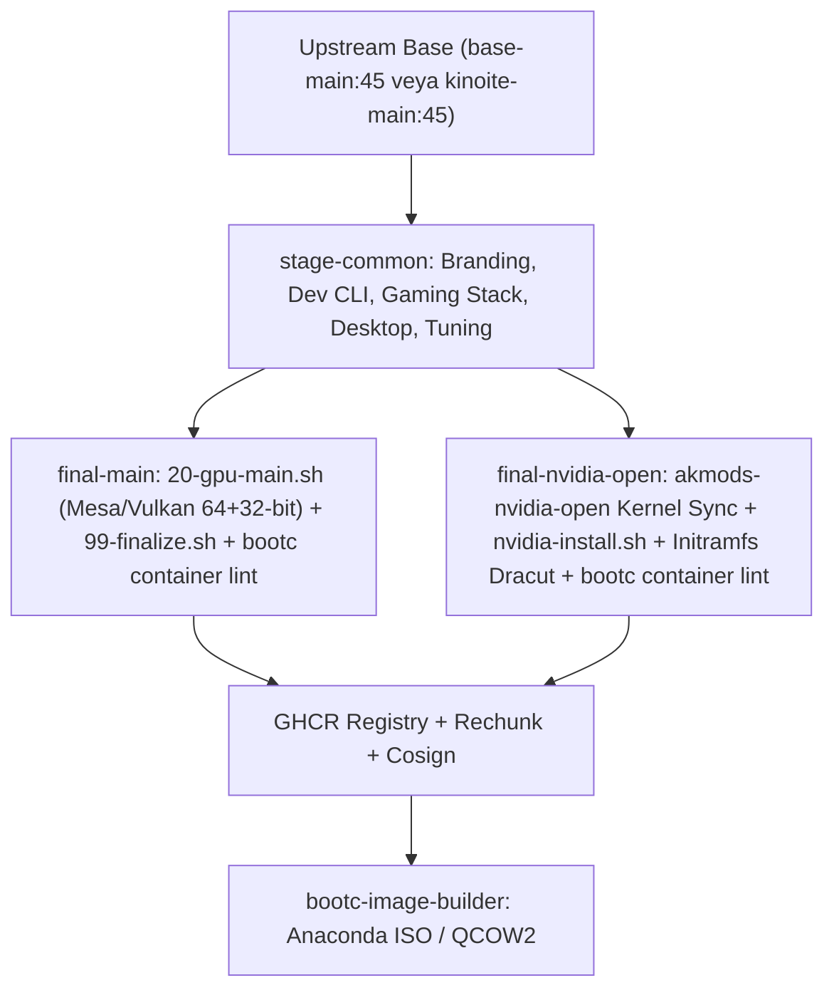

# Ender-OS Mimari ve Teknik Tasarım Belgesi

Bu belge, **Ender-OS** işletim sisteminin temel mimari kararlarını, katman yapısını, oyun ve yazılım geliştirme alt sistemlerini, özelleştirme motorunu ve CI/CD dağıtım hattını tanımlar.

---

## 1. Neden Fedora Atomic (`bootc`) Mimarisi?

Klasik ISO remaster veya `dnf`/`pacman` üzerinde manuel paket yığınlarıyla oluşturulan dağıtımlar zamanla "state drift" (durum kayması), kırılan sürücü güncellemeleri ve geri alınamayan sistem bozulmaları üretir. Ender-OS bu nedenle **OCI tabanlı bootable container (`bootc`)** yaklaşımını benimser:

1. **Atomik ve Güvenli Güncellemeler:** Tüm işletim sistemi (`/usr` dahil) imzalanmış tek bir OCI imajı olarak dağıtılır. Güncelleme arka planda hazırlanır ve yeniden başlatmada devreye girer.
2. **Anında Geri Alma (`Rollback`):** Yeni bir güncelleme veya sürücü sorunu yaşanırsa `ender-ctl rollback` (veya önyükleyicide önceki dağıtımı seçmek) ile sistem saniyeler içinde önceki çalışan durumuna döner.
3. **Sürüm Değiştirme (`Switch`):** Kullanıcı aynı kurulum üzerinde yeniden format atmadan `ender-ctl switch plasma-nvidia` komutuyla masaüstü veya GPU yığınını değiştirebilir.
4. **Temiz Ana Sistem + İzole Geliştirme:** Çekirdek işletim sistemi hafif tutulur; dil araç zincirleri ve proje bağımlılıkları `Distrobox` ve `Podman` içinde izole edilir.

---

## 2. Çok Aşamalı `Containerfile` ve Sürüm Matrisi

Ender-OS tek bir parametrik `Containerfile` üzerinden **4 resmi sürüm** üretir:

| Sürüm | Temel İmaj | Masaüstü | GPU Yığını | Hedef Kitle |
| :--- | :--- | :--- | :--- | :--- |
| `ender-os-hyprland` | `ghcr.io/ublue-os/base-main:45` | Hyprland (Wayland) | AMD & Intel Mesa/Vulkan | Ultra hafiflik, klavye odaklı akış |
| `ender-os-hyprland-nvidia` | `ghcr.io/ublue-os/base-main:45` | Hyprland (Wayland) | NVIDIA Open (`akmods-nvidia-open`) | NVIDIA + tiling Wayland masaüstü |
| `ender-os-plasma` | `ghcr.io/ublue-os/kinoite-main:45` | KDE Plasma 6 (Wayland) | AMD & Intel Mesa/Vulkan | Olgun HDR/VRR oyun ve masaüstü |
| `ender-os-plasma-nvidia` | `ghcr.io/ublue-os/kinoite-main:45` | KDE Plasma 6 (Wayland) | NVIDIA Open (`akmods-nvidia-open`) | NVIDIA + HDR/VRR KDE masaüstü |

### NVIDIA Open Entegrasyon Stratejisi
Universal Blue'nun eski `*-nvidia` imajları emekliye ayrıldığı için (`ublue-os/main#927`), Ender-OS doğrudan `ghcr.io/ublue-os/akmods-nvidia-open:main-45` önbellek katmanını bağlar:
1. Çekirdek sürümü `akmods-nvidia-open` içindeki `kernel-rpms` ile senkronize edilir.
2. `nvidia-install.sh` üzerinden sürücü, CUDA kütüphaneleri, 32-bit Vulkan/GL multilib ve `nvidia-container-toolkit` kurulur.
3. `nouveau` Vulkan ICD dosyaları temizlenir, `nvidia-modeset.conf` kalıcılaştırılır ve `dracut` ile erken açılış (early KMS) initramfs yeniden üretilir.

---

## 3. Oyun Alt Sistemi (`Gaming Subsystem`)

* **Grafik & Uyumluluk:** 64-bit ve 32-bit (`.i686`) `vulkan-loader`, `mesa-vulkan-drivers` (veya NVIDIA multilib), `steam`, `lutris`, `wine-core`, `winetricks`, `gamescope` (`cap_sys_nice=eip` yetkisi ile) ve `mangohud`.
* **Konsol Oturumu:** SDDM üzerinden doğrudan seçilebilen `Ender-OS Gaming Console (Gamescope)` oturumu (`ender-gamescope-session`), Steam Big Picture (`-gamepadui -steamos3`) arayüzünü VRR ve MangoApp desteğiyle açar.
* **Çekirdek ve Zamanlama İyileştirmeleri:**
  * `vm.max_map_count = 2147483642` (büyük bellek haritalı AAA oyunlar için).
  * `kernel.split_lock_mitigate = 0` (Proton/Wine altında mikro-takılmaları azaltmak için).
  * `ntsync` çekirdek modülü ve udev izin kuralı (`/dev/ntsync`).
  * `zram-generator` ile ZSTD sıkıştırmalı dinamik RAM takası.
  * NVMe için `none`, SATA SSD için `mq-deadline`, HDD için `bfq` I/O zamanlayıcıları.
  * `PipeWire` düşük gecikme profili (`quantum = 256`, `min-quantum = 64`).
  * Opsiyonel `scx-scheds` (`scx_lavd` / `scx_bpfland`) kullanıcı alanı CPU zamanlayıcı desteği.

---

## 4. Geliştirici Ekosistemi ve İzolasyon

* **Host Üzerinde Hafif Çekirdek:** `git`, `git-lfs`, `gh`, `podman`, `podman-compose`, `podman-docker`, `distrobox`, `neovim`, `tmux`, `zsh`, `fish`, `starship`, `ripgrep`, `fd-find`, `bat`, `fzf`, `jq`, `just`, `btop`, `fastfetch`, `direnv`.
* **Bildirimsel Devbox Profilleri (`stacks.json`):** Tek komutla izole geliştirme konteynerleri:
  * `ender-ctl devbox create rust` -> `rustup`, `cargo`, `clang`, `lld`, `mold`, `cmake`, `gdb`
  * `ender-ctl devbox create web` -> `nodejs`, `npm`, `sqlite`, `ripgrep`
  * `ender-ctl devbox create python` -> `python3`, `uv`, `python3-devel`, `sqlite`
  * `ender-ctl devbox create cpp` -> `clang`, `cmake`, `ninja`, `vulkan-headers`, `SDL2-devel`, `valgrind`
  * `ender-ctl devbox create arch-lab` -> `base-devel` destekli Arch konteyneri

---

## 5. `ender-ctl` ve Canlı Tema Motoru

`ender-ctl`, yalnızca Python 3 standart kütüphanesini kullanan dış bağımlılıksız sistem yönetim aracıdır:

* **Performans Profilleri:** `gaming`, `balanced`, `dev`, `powersave` (Hyprland üzerinde `Super + G` ile anlık Gaming Mode geçişi, efekt ve bildirim susturma kontrolü).
* **Tema Sistemi:** `/usr/share/ender-os/themes/` altında `ender-obsidian`, `ender-nordic` ve `ender-crimson` temaları bulunur. Tema değiştirildiğinde `~/.config/ender-os/current-theme` sembolik bağı güncellenir; Hyprland, Waybar, Kitty ve Rofi canlı olarak yenilenir.
* **Sistem Sağlığı ve Bakım:** `ender-ctl status`, `ender-ctl doctor`, `ender-ctl update`, `ender-ctl rollback`, `ender-ctl switch`.

---

## 6. CI/CD ve İmzalama Mimarisi

* `.github/workflows/ci.yml`: Her push ve PR'da `just --list`, `shellcheck`, `tests/validate_repo.py` ve `tests/test_ender_ctl.py` testlerini çalıştırır.
* `.github/workflows/build-images.yml`: 4 sürümü paralel olarak derler, `rpm-ostree compose build-chunked-oci` ile delta optimizasyonu yapar, GHCR'ye yükler ve `COSIGN_PRIVATE_KEY` tanımlıysa Sigstore Cosign ile imzalar.
* `.github/workflows/build-iso.yml`: `bootc-image-builder` kullanarak `anaconda-iso` ve `qcow2` çıktıları ile `SHA256SUMS` üretir.

---

## 7. Yol Haritası

* **v0.1 — Temel Mimari & CI/CD (Mevcut Aşama):** 4 çekirdek sürüm, modüler derleme scriptleri, `ender-ctl`, 3 tema, ISO/VM derleme hatları, doğrulama testleri.
* **v0.2 — ISO Doğrulama & Donanım Testleri:** Gerçek donanım ve QEMU/KVM üzerinde Anaconda kurulum testleri, Cosign imza zorunluluğu ve `cosign.pub` dağıtımı.
* **v0.3 — Grafik Kontrol Merkezi:** `ender-ctl --json` arayüzünü kullanan hafif yerel Wayland/GTK4 veya QML kontrol paneli.
* **v1.0 — Kararlı Sürüm:** Düzenli günlük/haftalık imaj kanalları (`stable`, `testing`), ilk açılış hoş geldin sihirbazı ve kapsamlı kullanıcı rehberleri.
